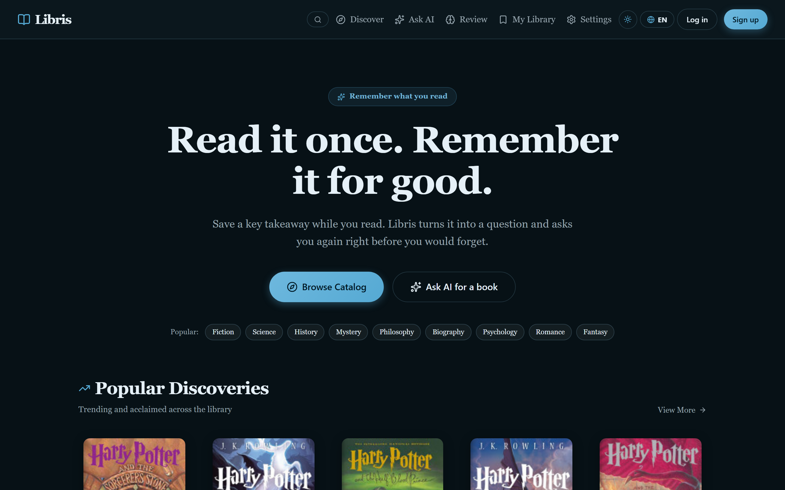
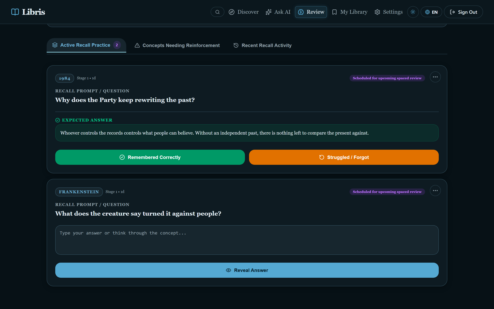
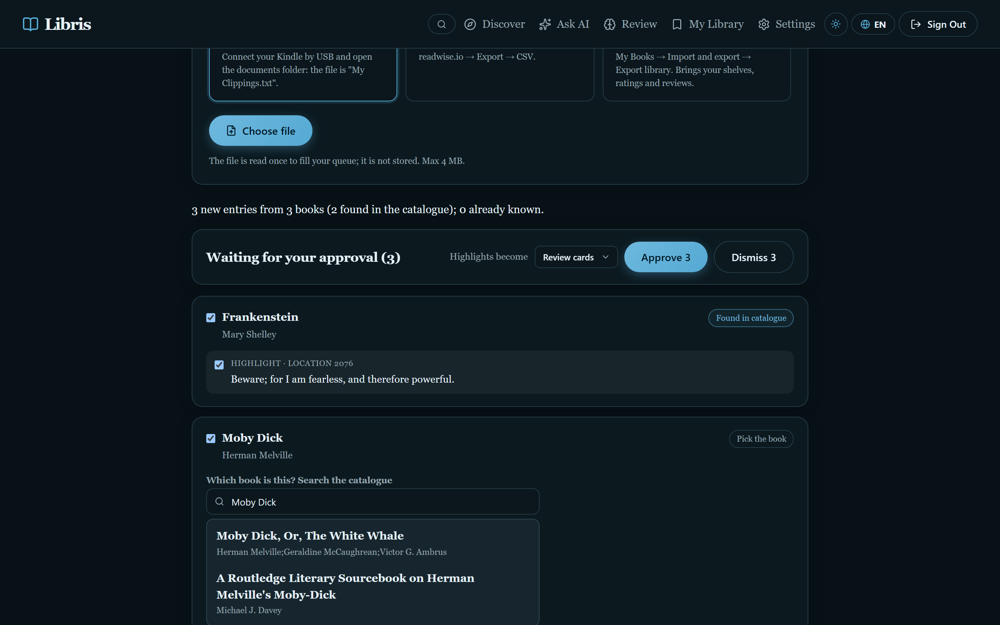
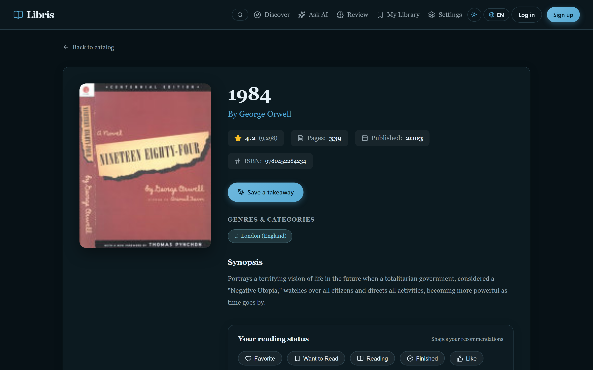
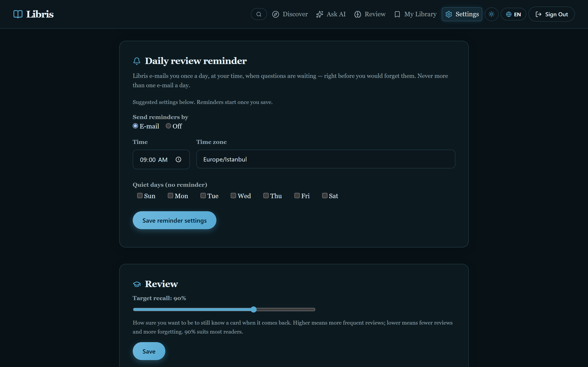
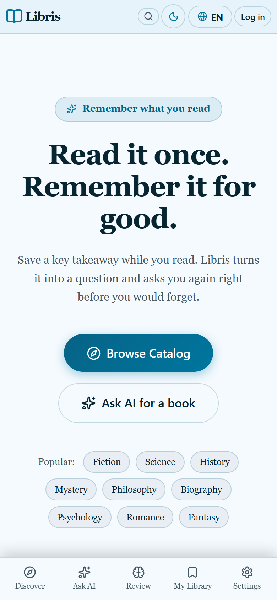
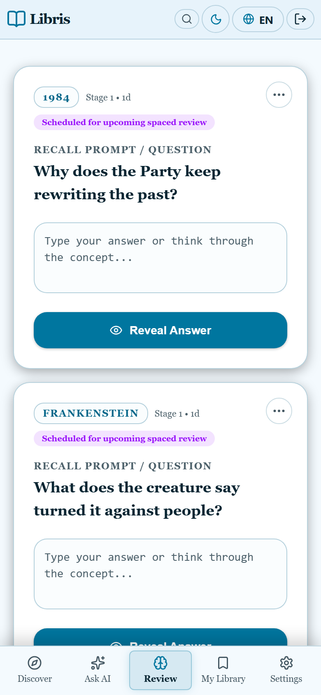
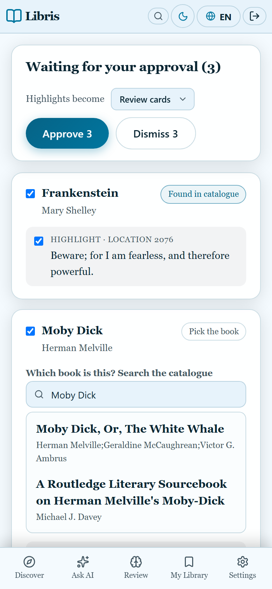
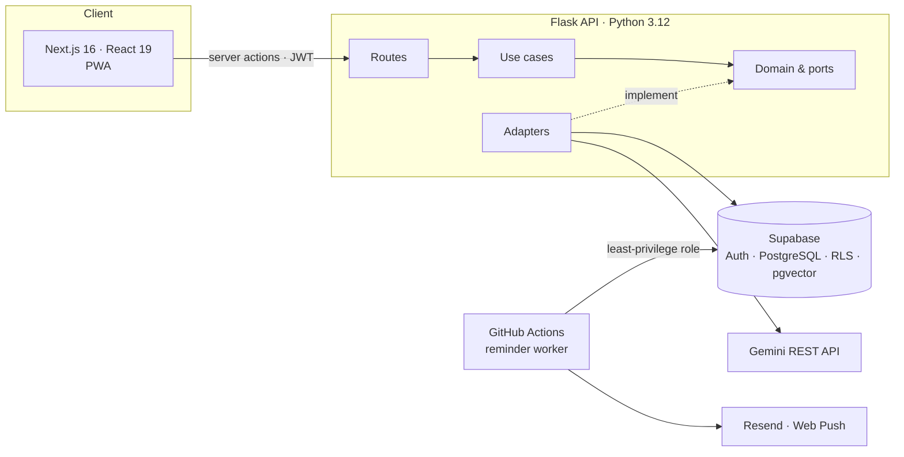

<div align="center">


# Libris

**Read it once. Remember it for good.**

A reading companion that turns what you highlight into questions, and asks them again right before you would forget.

[](https://github.com/akifkeklik/libris/actions/workflows/ci_cd.yml)
[](LICENSE)
[](https://www.python.org/)
[](https://nextjs.org/)
[](https://www.postgresql.org/)

[**Live demo**](https://libris-pink.vercel.app) · [Architecture](docs/ARCHITECTURE.md) · [Product brief](docs/PRODUCT.md) · [Engineering handover](docs/engineering/FINAL_ENGINEERING_HANDOVER.md)



</div>

## Why

Most of what we read is gone within weeks. Flashcard apps fix that, but only if you write every card by hand. Libris makes reviewing a by-product of reading: save one idea in your own words, or import the highlights you already have, and the questions take care of themselves.

## How it works

| 1. Capture | 2. Recall | 3. Return |
|---|---|---|
| Save a takeaway from a book page, or import Kindle, Readwise and Goodreads files. | Gemini turns each takeaway into one question; your own words are the answer. | Cards come back on a spaced schedule, with a daily reminder at your hour. |

## A closer look

<table>
<tr>
<td width="50%"><br /><b>Review.</b> Answer first, then reveal. Edit a card, ask for a new question, or report a bad one.</td>
<td width="50%"><br /><b>Import.</b> Highlights wait in a queue; nothing is added until you approve it.</td>
</tr>
<tr>
<td><br /><b>Book page.</b> Save a takeaway, track your status, find similar books.</td>
<td><br /><b>Reminders.</b> Your time, your time zone, quiet days, at most one a day.</td>
</tr>
</table>

<div align="center">



<br />
<sub>One responsive web app, installable as a PWA. Screenshots show the real app running locally with demo data; Frankenstein and Moby-Dick quotes are public domain.</sub>
</div>

## Features

| | |
|---|---|
| **Recall questions** | One AI question per takeaway, with a fallback that never blocks saving. Model calls are capped per request. |
| **Spaced repetition** | Fixed 1/3/7/14/30-day stages by default; [FSRS](https://github.com/open-spaced-repetition/py-fsrs) with a target-recall setting behind a feature flag. |
| **Imports** | Kindle (8 label languages), Readwise, Goodreads; source-independent de-duplication, conservative book matching, PWA share target. |
| **Reminders** | Daily e-mail or Web Push, idempotent per reader and day, one-click unsubscribe. |
| **Discovery** | About 6,400 books, TF-IDF similar books, and an Ask AI assistant grounded in the catalogue (pgvector + Gemini). |
| **Your data** | Full export, Anki `.apkg` export, self-service account deletion. |
| **Accessible and multilingual** | Six languages, keyboard-first controls, contrast-checked light and dark themes. |

## Architecture



Dependencies point inwards: use cases know ports, never Supabase or Gemini. That is why the whole app also runs offline with in-memory adapters, which is how the screenshots and signed-in browser checks are produced.

| Area | Technologies |
|---|---|
| Web | Next.js 16, React 19, TypeScript, Tailwind CSS 4 |
| Backend | Python 3.12, Flask 3, scikit-learn, pandas |
| Data | Supabase Auth, PostgreSQL 16, row-level security, pgvector |
| AI | Google Gemini over REST, py-fsrs |
| Delivery | Vercel, Render, GitHub Actions, Docker |

### Decisions worth reading

- **Isolation in the database.** Reader tables use row-level security, checked by SQL tests that act as two different readers. Where a direct `DATABASE_URL` is configured, notes and interactions rely on query filters instead; the [database audit](docs/engineering/RENDER_DATABASE_SECURITY_AUDIT.md) covers that trade-off.
- **A reminder worker that can do almost nothing.** It gets only the readers due right now (address, count, first question), push devices and a send log; it cannot read notes, cards or the preferences table.
- **No generic filler cards.** When the AI budget is spent, notes wait for a real question instead of getting a permanent placeholder.
- **A "flaky" test that was a real bug.** On a threaded server, two simultaneous chats could corrupt a shared data frame and take recommendations down. The [story and the fix](docs/engineering/PHASE_4_REPORT.md).

## Quality

More than 1,290 backend tests, almost 290 web unit tests and 89 browser tests run on every pull request, together with linting, dependency audits, Docker builds and every migration applied to a throwaway PostgreSQL.

```bash
ruff check backend/ && PYTHONPATH=. python -m pytest backend/tests/
cd web && npm run lint && npm test && npm run build && npm run test:e2e
```

## Run locally

Requires Python 3.12, Node.js 22 and a Supabase project. Full guide: [docs/setup.md](docs/setup.md).

```bash
# Backend: copy backend/.env.example to .env in the repo root and fill it in
python -m venv .venv && source .venv/bin/activate   # Windows: .venv\Scripts\Activate.ps1
pip install -r backend/requirements-test.txt
python -m backend.app                               # http://localhost:5000

# Web: copy web/.env.example to web/.env.local and fill it in
cd web && npm ci && npm run dev                     # http://localhost:3000
```

On Windows, `scripts/launch_dev.ps1` starts both.

## Deployment and status

`main` deploys to Vercel (web) and Render (API). The API runs on a free tier that sleeps when idle, so the first visit after a quiet spell can take up to a minute.

Features that need newer database migrations (`16` to `20`) or extra keys, such as reminders, imports and account deletion, are complete and tested in code; they become active in an environment once the [production checklist](docs/engineering/PRODUCTION_READINESS_CHECKLIST.md) is done there.

Ordered migrations live in `backend/scripts/` (`00` to `20`) and are applied deliberately, never automatically. Migration 14 drops retired tables, so back up first and read [docs/supabase_setup.md](docs/supabase_setup.md).

## Documentation

| Topic | Where |
|---|---|
| Architecture, design system | [ARCHITECTURE](docs/ARCHITECTURE.md) · [DESIGN_SYSTEM](docs/DESIGN_SYSTEM.md) |
| Phase reports | [1](docs/engineering/PHASE_1_REPORT.md) · [2](docs/engineering/PHASE_2_REPORT.md) · [3](docs/engineering/PHASE_3_REPORT.md) · [4](docs/engineering/PHASE_4_REPORT.md) · [5](docs/engineering/PHASE_5_REPORT.md) · [UI review](docs/engineering/UI_UX_REVIEW_REPORT.md) |
| AI evaluation and readiness | [Live evaluation](docs/engineering/AI_LIVE_EVALUATION_REPORT.md) · [Gemini readiness](docs/engineering/GEMINI_PRODUCTION_READINESS.md) |
| Going to production | [Checklist](docs/engineering/PRODUCTION_READINESS_CHECKLIST.md) · [Runbook](docs/engineering/PHASE_0_PRODUCTION_RUNBOOK.md) |

Some engineering reports are written in Turkish.

## Security

Keep credentials in local env files, never in git. The Supabase service-role key stays on the server, and `ALLOWED_ORIGINS` must list trusted origins explicitly in production.

## License

[MIT](LICENSE) · Built by [Akif Keklik](https://github.com/akifkeklik)
